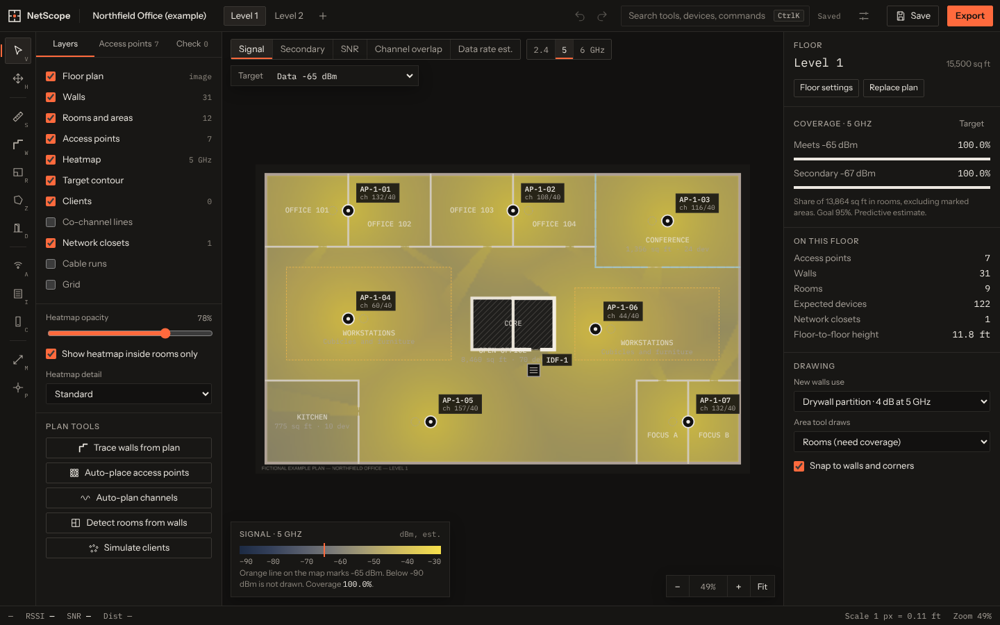
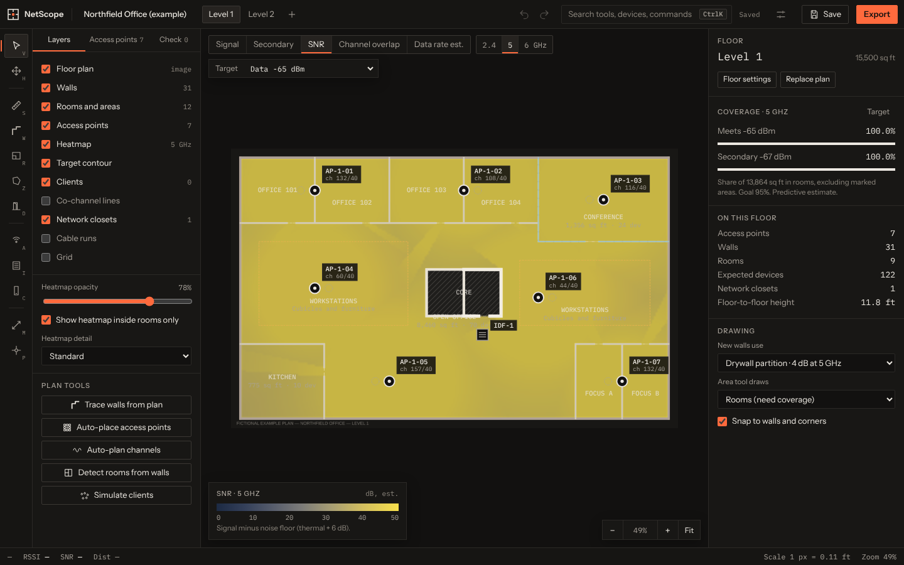
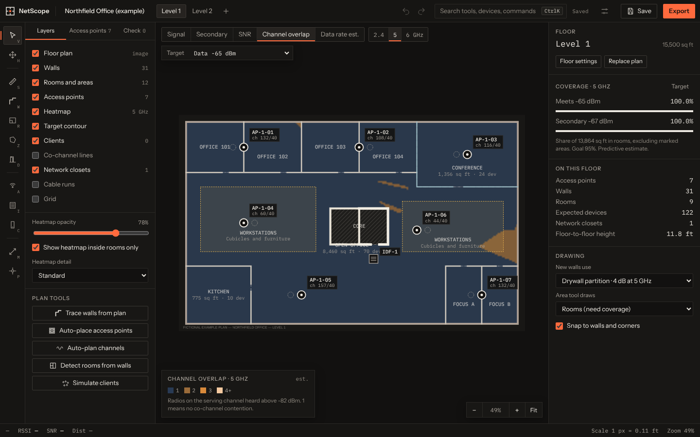
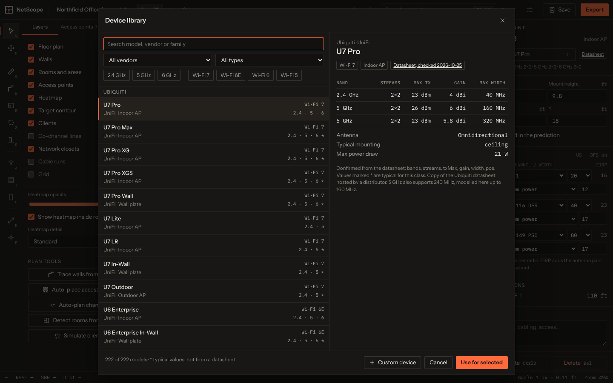
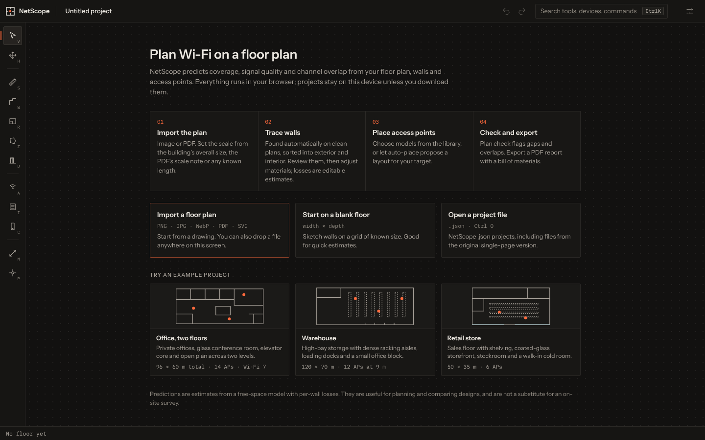
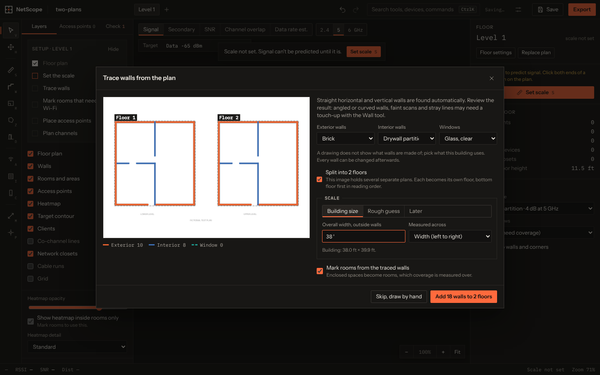
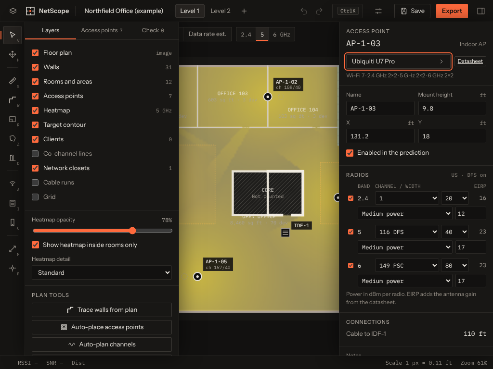

# NetScope

NetScope is a browser-based predictive Wi-Fi planning tool. Import a floor plan, set its scale, draw walls and rooms, place access points from a library of current models, and see predicted signal, secondary coverage, SNR, channel overlap and estimated data rate on 2.4, 5 and 6 GHz. It runs entirely in the browser: plans and projects never leave the machine.

> NetScope produces predictive estimates, not a substitute for an on-site survey. Wall losses, device specifications marked "typical / unverified", noise floor and throughput are modelled values. Validate any design with a site survey before it is installed.



## Features

**Plans and floors**
- Import PNG, JPEG, WebP or PDF floor plans (PDF pages are rendered locally; you choose the page). Files are checked by content, size-limited and never executed.
- Trace walls automatically after importing: straight walls are found in the image, sorted into exterior and interior, windows detected in exterior walls, and rooms marked. Pick a material for each group, review the preview, then fix any misses with the Wall tool. One undo removes the whole trace.
- Set the scale from the overall building size printed on most plans (type `45'6"` or `13.9 m`), from a PDF's scale note such as `1/4" = 1'-0"` or `1:100`, or by drawing a line of known length. A rough guess from door widths is offered when nothing else is available, labelled as such.
- Sheets with several plans on one image (basement, ground floor, upper floor) can be split into separate floors in one step.
- Multiple floors with floor-to-floor height, alignment offsets and slab loss between floors. APs on adjacent floors contribute signal.
- Start from a blank floor of a given size if you have no plan.

**Modelling the building**
- Walls with per-band materials (drywall, glass, coated glass, wood, brick, block, two concrete thicknesses, metal) and editable losses. Losses apply only where a path actually crosses a wall.
- Door gaps, rectangular rooms, polygon areas and automatic room detection from drawn walls.
- Attenuation areas (cubicles, shelving, dense racking, crowds) that add loss per meter travelled inside them, and exclusion areas that are left out of coverage statistics.

**Access points**
- A library of 222 indoor and outdoor access points and mesh/home routers from 20 vendors, filterable by vendor, band and Wi-Fi generation. 27 models carry values checked against a published datasheet, with the source and date on the spec sheet; the rest use typical values for their class and are labelled "Typical / unverified". See [docs/devices.md](docs/devices.md).
- Custom devices with your own transmit power, antenna gain, streams and pattern.
- Per-radio channel, width and power, power presets, mount height, orientation for directional antennas, enable/disable per AP and per band.
- Indicative EIRP limit warnings for the US and EU regions, DFS channel marking and 6 GHz preferred scanning channels.

**Analysis**
- Views: signal, secondary signal (second-strongest AP), SNR, channel overlap (co-channel APs heard above −82 dBm) and estimated data rate, each with a colour-blind-safe scale, legend and threshold marker.
- Coverage targets with presets (voice −67 dBm with secondary −67 dBm, data −65 dBm, basic −72 dBm) or custom values, and a coverage goal. The inspector shows the share of room area meeting the target.
- Signal probe and live status bar readings (RSSI, SNR, serving AP, distance) under the pointer.
- Simulated clients joined to the strongest AP, with per-client link estimates.
- Plan check: missing scale, unsupported channels or widths, power above device maximum, EIRP over the indicative limit, co-channel pairs, cable runs over the limit, PoE budget, unverified devices.

**Planning helpers**
- Auto-place access points to meet the coverage target (and a simple capacity floor) on the chosen band, keeping or replacing existing APs.
- Auto-plan channels using predicted AP-to-AP coupling, with optional DFS.
- Network closets with estimated cable runs (rectilinear path, vertical drop and slack) and PoE totals.
- Design versions: save snapshots and compare AP count, coverage and cost.

**Output**
- PDF report: cover with assumptions and disclaimer, a map per floor and band, AP schedule, bill of materials with spec provenance and optional prices, closets and PoE, capacity, plan check and the materials table.
- PNG image of the current view, CSV of the AP schedule (protected against spreadsheet formula injection).
- Project files (`.netscope.json`) that open in any copy of NetScope. Older NetScope v1 files are migrated on open. Projects also autosave in the browser.

**Working in the app**
- Undo and redo for every edit, keyboard shortcuts for all tools (press `?`), and a command palette (`Ctrl K` / `Cmd K`).
- Pan and zoom with mouse, trackpad, touch and pinch. Usable on tablets; phones work for viewing and light edits.
- Three fictional example projects: a two-floor office, a warehouse and a retail store.

| | |
|---|---|
|  |  |
|  |  |
|  |  |

## Running it

Requires Node.js 20 or later.

```sh
npm install
npm run dev        # development server with hot reload
npm run build      # production build into dist/
npm run preview    # serve dist/ on http://localhost:4173
```

### Deploying

NetScope is built from source, so the host must run `npm run build` and serve the `dist` folder. Uploading the source files on their own shows a blank page.

**GitHub Pages**: the included workflow (`.github/workflows/deploy-pages.yml`) builds and publishes on every push to `main`. In the repository, open Settings, Pages, and set Source to "GitHub Actions" once.

**Cloudflare Pages**


- Build command: `npm run build`
- Build output directory: `dist`

`public/_headers` is copied into the build and sets a strict Content Security Policy and other security headers. The app is fully static and needs no server code.

### Tests

```sh
npm test                          # unit tests (Vitest)
npx playwright install chromium   # once, if Playwright has no browser yet
npm run test:e2e                  # end-to-end tests at desktop and tablet sizes, plus a performance check
npm run check                     # all of the above
npm run screenshots               # regenerate docs/screenshots (with npm run preview running)
```

## How the prediction works

All internal distances are in meters; feet are used only for display.

**Free-space path loss** with distance in meters and frequency in MHz:

```
FSPL(dB) = 20·log10(d) + 20·log10(f) − 27.55
```

With distance in feet the constant is −37.87. Distance is the 3-D distance between the AP at its mount height and a client at the configured height (default 1 m), with a 0.1 m minimum so the logarithm is always defined. An optional path-loss exponent `n` replaces the 20·log10(d) term with `10·n·log10(d)` beyond 1 m; the default `n = 2.0` is free space.

**Received signal** at each point:

```
RSSI = Tx power + AP antenna gain(angle) + client antenna gain
       − path loss
       − sum of wall losses for walls the path crosses (per band)
       − attenuation-area loss per meter × length of path inside the area
       − slab loss × floors crossed
```

Directional antennas use a smooth main lobe, `−12·(θ / beamwidth)²` dB, floored at the front-to-back ratio.

**Noise floor**: `−174 + 10·log10(channel width in Hz) + 6 dB` (thermal noise plus a typical receiver noise figure), or a measured value you enter. SNR is RSSI minus noise floor.

**Data rate (estimate)**: the highest MCS whose SNR threshold is met (the table is editable) gives modulation and coding rate. The PHY rate is computed from the 802.11 data subcarriers for the channel width, bits per symbol, coding rate, spatial streams (the lower of AP and client) and symbol time (3.6 µs for Wi-Fi 4/5, 13.6 µs for Wi-Fi 6/6E/7). The displayed rate is the PHY rate × 0.65 efficiency, for one client at a time. Real throughput depends on airtime contention, retries and client capability.

**Channel overlap** counts APs on the same or overlapping channel heard above −82 dBm (the 802.11 preamble detection level) at each point.

The model has no reflections, diffraction or multipath. Material losses come from published measurements where possible and are estimates; see [docs/materials.md](docs/materials.md). Regulatory figures are indicative only; see [docs/regulatory.md](docs/regulatory.md).

## How wall tracing works

Tracing is classical image processing in a Web Worker, with no OCR, machine-learning model or network access, so it adds about 13 kB and works offline. It looks for long straight strokes that are clearly thicker than the plan's line work (or pairs of outlines with a filled or hatched core), joins them at corners and junctions, and keeps gaps as door openings. Gaps with glazing lines in exterior walls become windows. A morphological closing of each wall network gives the building outline; walls on that outline are exterior.

It works best on clean, axis-aligned plans exported from drawing software. Angled and curved walls are not traced, low-resolution or photographed plans give partial results, and text set in very heavy type can occasionally be picked up. The result is always shown for review before it is added. A plan image does not say what a wall is made of, so materials are chosen by the user.

## Which numbers are estimates

- Wall and area losses: published typical values or estimates, editable per project.
- Device specifications marked "Typical / unverified" (or marked with `*` on a spec sheet).
- Noise floor (unless you enter a measured one), MCS thresholds, the 0.65 efficiency factor and therefore every data rate.
- Cable run lengths (rectilinear path plus allowances) and capacity figures (devices per radio).
- The scale guessed from door widths (assumes a 0.84 m opening) and the exterior or interior split from tracing.
- EIRP limits, which are a simplified summary of US and EU rules and not a compliance check.

## Privacy and security

Floor plans and projects stay in your browser. Uploaded files are checked by content and size; project files are parsed as data and validated field by field, and embedded images must be base64 PNG, JPEG or WebP. PDF.js runs with script evaluation disabled. Nothing from a file is executed or inserted as HTML.

## Project layout

```
src/core       propagation model, geometry, channels, schema and analysis (no UI)
src/data       device library and verified datasheet values
src/worker     heatmap and planning computations off the main thread
src/canvas     floor plan renderer and interaction
src/ui         interface components
src/io         plan import, project files, PDF/PNG/CSV export
tests          unit and end-to-end tests
docs           materials, regulatory notes, device sources, screenshots
```

## License

MIT. See [LICENSE](LICENSE).
